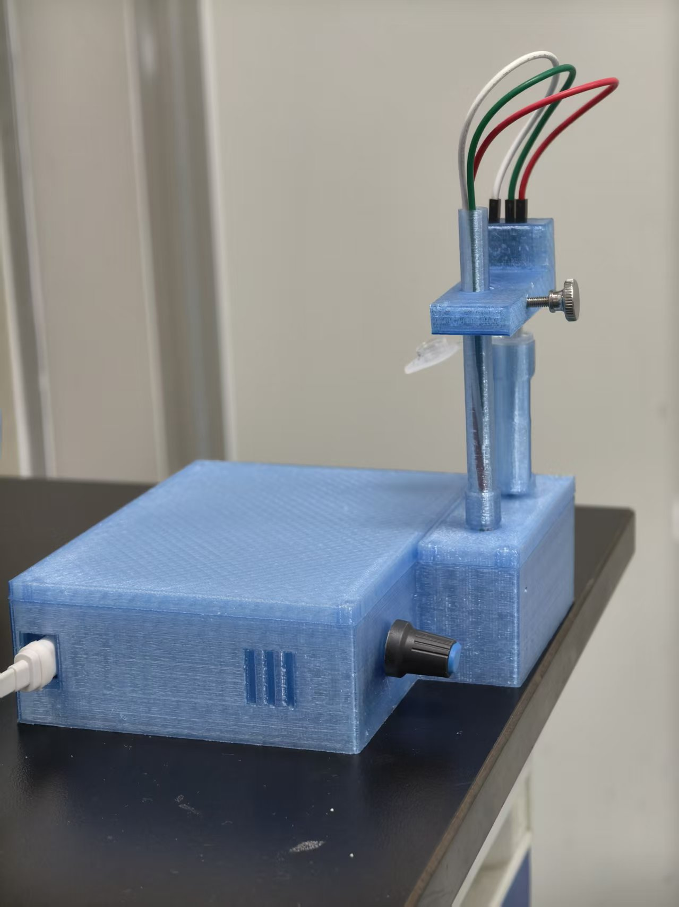
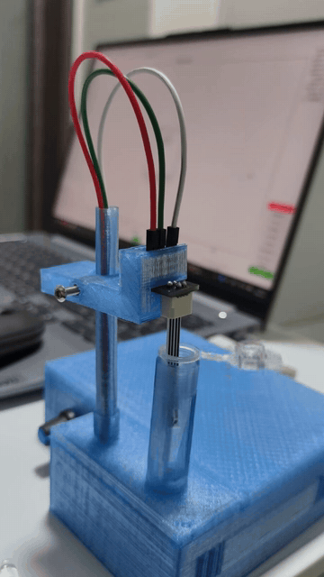

# PSoC-Potentiostat-YI-1.0

> Fork of [Kyle Lopin's PSoC-Potentiostat](https://github.com/KyleLopin/PSoC-Potentiostat)（原作者：Kyle Vitautas Lopin，Naresuan University）。
> 本分支由 Zhijian Yi（中国广东）维护，遵循上游许可证 CC BY-SA 3.0。

一个基于 CY8CKIT-059（PSoC 5LP）的开源恒电位仪分支：Python 3 中文化 GUI、真 DPV 固件补丁、CV 多圈、搅拌控制、真机实测套件。


*整机外观（最终版：电极支架改用手拧螺丝）*

▶️ **实机演示**（4.5 s 装配早期版本，结构与最终版一致，演示更直观；带声音原片见 [Release v1.0](https://github.com/LLLIO400/PSoC-Potentiostat/releases/tag/v1.0) 附件）：



**下载 Download**：运行包 / 测试包见 [Releases v1.0](https://github.com/LLLIO400/PSoC-Potentiostat/releases/tag/v1.0)。

**配套固件 Firmware**：完整 PSoC Creator 工程与刷机图文说明见 [`YI-1.0-firmware` 分支](https://github.com/LLLIO400/PSoC-Potentiostat/tree/YI-1.0-firmware)。

**完整说明文档 Full documentation**：[`PSoC-Potentiostat-YI-1.0_upgrade_guide.md`](PSoC-Potentiostat-YI-1.0_upgrade_guide.md) —— 硬件方案、固件命令与刷机、界面与数据分析、接线总表、推荐验证试剂、已知局限（中文）。

---

## 与上游的主要差异（中文）

1. **上位机重构**：Python 2 → Python 3 迁移；代码重构为 10 个模块；ttkbootstrap 界面美化；完整中英文国际化（默认中文）。
2. **新功能**：
   - 独立 DPV 实验页（配合自研固件 `'P'` 命令补丁，上游固件无真 DPV）；
   - CV 多圈（固件 `'S|…|N'` 波形表补丁，1–9 圈零间隙连续循环；超容量自动降级软件逐圈）；
   - 搅拌控制（固件 `'O'` 命令补丁 + ASV 流程自动启停）；
   - 扫描前静置（消除电位跳变暂态的起点负漂）；
   - 数据处理算法：Savitzky-Golay 平滑、框选基线扣除、自动寻峰、标准曲线定量（外标法 / 标准加入法）；
   - 每次扫描自动备份（autosave_backup/），CSV 带元数据头、可回读并自动路由到对应实验页。
3. **质量保障**：80 类软件测试（虚拟串口模拟固件）+ 9 项真机自动判定实测（连接/标定/LS/CV/SWV/DPV/重复扫描/中断恢复/计时电流），统一输出 `test_report.txt`。
4. **一批真机实测修复**：详见 `PSoC-Potentiostat-YI-1.0_upgrade_guide.md`（含固件 Sleep/Wakeup 配对问题的完整机理分析）。

### 安装与运行

```bat
install_env.bat   :: 安装 Python 依赖（pyserial / ttkbootstrap / scipy / matplotlib）
start_gui.bat     :: 启动 GUI
run_tests.bat     :: 测试包：环境诊断 + 全量测试（可选真机实测）
```

### 硬件改动

- 搅拌：ZK-TD2 延时继电器（P13 模式）触发调速器驱动马达，由 P2.0 控制（杜邦线连接即可）。搅拌转速由调速器一次性设定；PSoC 侧仅输出开关信号——如需软件调速，需固件增加 PWM 输出并外加一级驱动管，本方案为复用现成模块未采用。
- 详细接线见 `PSoC-Potentiostat-YI-1.0_upgrade_guide.md` 接线总表一节。

### 测试说明

本项目的修改设想几年前就已成形，却一直搁置至今——直到我离开实验室、告别电化学检测后才最终完成。因此部分测试较为粗糙：未能正式配制缓冲液体系，仅用手头现成的几种试剂做了验证。但实测结果足以证明：整套系统可以正常完成检测。

---

## Differences from upstream (English)

1. **GUI rework**: Python 2 → 3 migration, refactored into 10 modules, ttkbootstrap styling, full Chinese/English i18n (Chinese default).
2. **New features**: standalone DPV page (with a custom firmware `'P'` command patch — upstream firmware has no true DPV); multi-cycle CV (firmware `'S|…|N'` LUT patch, 1–9 seamless cycles with automatic software fallback beyond LUT capacity); stirring control (firmware `'O'` command + automated ASV timing); pre-scan quiet time; SG smoothing / region-selected baseline subtraction / automatic peak detection / calibration-curve quantitation (external standard & standard addition); per-scan autosave and metadata-headed CSVs that reload into the correct page.
3. **Quality assurance**: 80 software test classes with a firmware-emulating fake serial device, plus 9 auto-judged on-hardware tests, summarized into a single report file (`test_report.txt`).
4. **Real-hardware fixes**: documented in `PSoC-Potentiostat-YI-1.0_upgrade_guide.md`, including a full root-cause analysis of the firmware Sleep/Wakeup pairing issue.

### A note on testing

The revision plan for this project took shape years ago, but was postponed again and again — it was only finished after I had left the lab and moved on from electrochemical detection. As a result, some tests are relatively rough: no properly prepared buffer systems, only verification with the reagents I had on hand. Even so, the measured results are enough to show that the complete system works normally for detection.

### License

Upstream code: Copyright (c) 2015-2023 Kyle Lopin, CC BY-SA 3.0.
Modifications and new files: Copyright (c) 2026 Zhijian Yi, same license (CC BY-SA 3.0).
Please keep the upstream copyright headers when redistributing.
