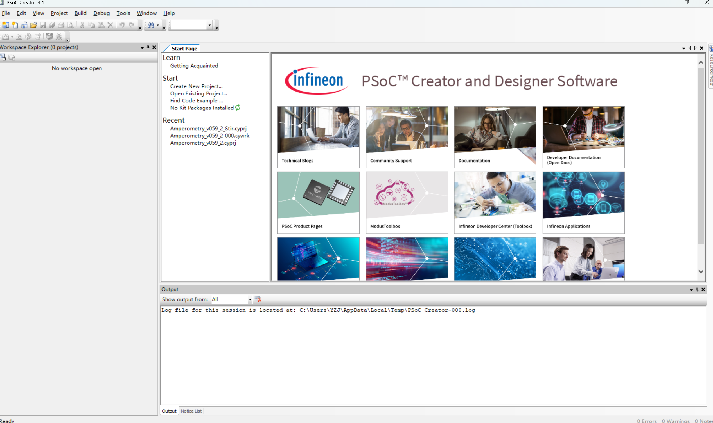
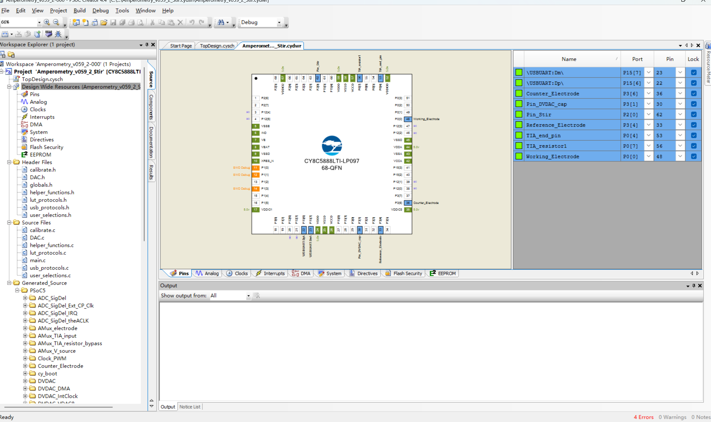
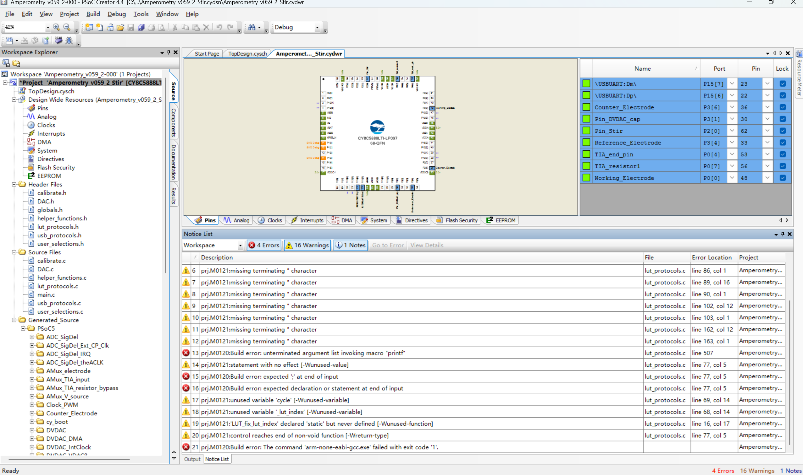
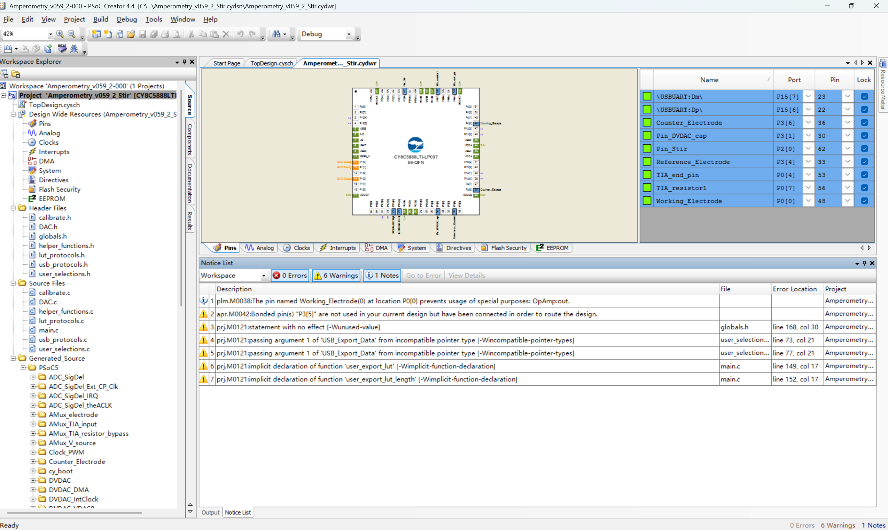
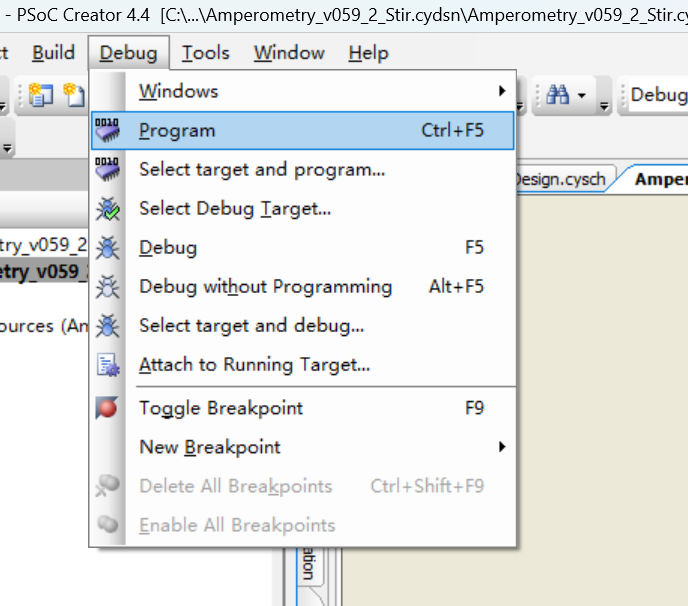
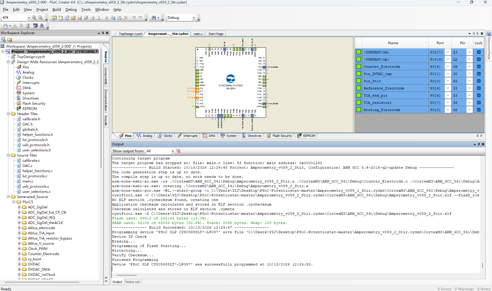
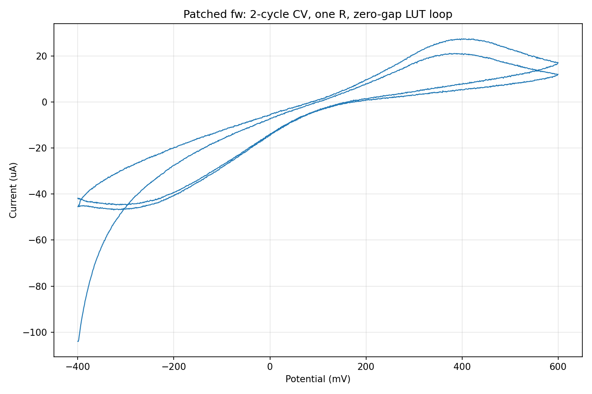

# 刷固件图文说明（PSoC 5LP · 合并固件）

> 适用工程：`Amperometry_v059_2_Stir.cydsn`（合并固件，一次刷入全部生效：
> **搅拌 'O' ＋ 真 DPV 'P' ＋ CV 多圈 'S|…|N' ＋ X 复位不休眠**）。
> 本文档按 2026-10-13 实刷过程整理，Windows 10/11 + PSoC Creator 4.4 + CY8CKIT-059 验证通过。

---

## 开始前必读（4 条硬性前提）

1. **工程路径必须纯英文**：PSoC Creator 4.4 打不开含中文的路径。工程在中文目录（如 `D:\04 娱乐\…`）时，先把**整个工程文件夹**复制到纯英文路径（如 `C:\Users\YZJ\Desktop\PSoC-Potentiostat-master`），在副本上操作。
2. **打开 `.cyprj`，不要开 `.cywrk`**。
3. **不要改任何名字**：`.cydsn` 文件夹与 `.cyprj` 必须同名（`Amperometry_v059_2_Stir`），改名会导致工程打不开或时钟配置丢失。
4. **Recent 列表别乱点**：启动页 Recent 里的工程可能指向旧路径，一律用 Open Existing Project… 重新选。

---

## 步骤 1：打开工程

启动 PSoC Creator 4.4 → **Start → Open Existing Project…** → 定位到工程目录 `…\Amperometry_v059_2_Stir.cydsn\` → 选 **`Amperometry_v059_2_Stir.cyprj`** → 打开。

打开成功后，Workspace Explorer 出现工程树；`.cydwr` 引脚页应能看到 `Pin_Stir (P2[0])` 等已锁定的引脚（搅拌引脚已在原理图中，无需添加）。

## 步骤 2：组件版本更新

若 Notice List 出现 `sdb.M0033 … cy_isr_v1_71` / `sdb.M0052 … cy_boot_v6_10`（无法定位组件）之类的错误：

**右键工程名 → Update Components… → 全选 → Finish**，等待迁移完成。

> 这是 Creator 自带组件版本与工程记录版本不一致导致的，属正常流程；迁移只是换成
> 本机 Creator 的组件版本，API 兼容，不影响固件功能。

## 步骤 3：编译

菜单 **Build → Clean and Build Amperometry_v059_2_Stir**。

- 预期结果：**0 Errors**，结束行 `Build Succeeded`；
- **Warnings 有一批属正常**（上游代码遗留的无害告警：unused value / incompatible pointer / implicit declaration 等），不影响功能。

> 若报时钟错误（`ILO must be set to 100 kHz` / `USB clock is disabled`）：
> `.cydwr` → Clocks → Edit Clock：IMO 选 24 MHz；ILO 勾 100 kHz 且 Route 选 100 kHz；
> 启用 USB 并选 IMOx2 (48 MHz) → Save All → 重新编译。

## 步骤 4：烧录

1. USB 线插到板子的 **J10**（KitProg 编程口）。
2. 菜单 **Debug → Program**（快捷键 Ctrl+F5）。

3. 等输出面板走完 `Erasing → Programming of Flash → Verify Checksum`，
   看到 **`Device 'PSoC 5LP …' was successfully programmed`** 即成功。

> 找不到设备时：确认插的是 J10；KitProg 处于 USB-UART 桥模式时按板上开关切回
> 编程模式，或换一个 USB 口。刷坏不影响 KitProg，可反复重刷。

## 步骤 5：切回串口

烧录完成后 **拔下 J10，插回 J1**（USB 串口口，给上位机 GUI 用），板子重新上电、新固件干净启动。

## 步骤 6：验证

打开 GUI（或任意串口工具）连接设备，跑一次 CV 多圈：

- **多圈能力探测**：GUI 发参数后用 `'g'` 回读波形表长度——长度等于"N 圈期望值"即补丁生效
  （实测：-400~600 mV 设 2 圈，回读 **4002**，与理论值一致）；
- **连续循环**：单次运行命令连续跑完全部圈数，无圈间停顿。实测 2 圈用时 **20.1 s**（理论 20.0 s），
  数据 4001 点完整，曲线两圈无缝衔接：

---

## 附 A：循环圈数与波形表容量

- 波形表（LUT）共 **5000 点**，每圈占用 `2 × 电位范围步数 + 1` 点；
- **容量内**（如 -400~600 mV 最多 2 圈）：固件零间隙连续循环，一次运行跑完；
- **超出容量**（如 -400~600 mV 设 6 圈）：GUI 发单圈波形表、自动改用**软件逐圈调度**
  连续跑满设定圈数，圈间约停 1 秒，同样无需手动操作——启动扫描时会弹窗提示本次使用的调度方式（中/英文随界面语言）；
- 想要更多圈的零间隙循环：收窄电位范围（如 -200~600 mV 可容 3 圈）。

## 附 B：命令速查

| 命令 | 功能 |
|---|---|
| `S\|start\|end\|div\|CS\|N` | CV 多圈（N=1–9，LUT 连续循环） |
| `G` | SWV 波形表 |
| `P` | 真 DPV 波形表 |
| `O\|1` / `O\|0` | 搅拌开 / 关（P2.0 → 继电器） |
| `g` | 回读波形表长度（多圈能力探测） |
| `X` | 复位（本固件不再休眠硬件，复位后可直接重连） |
